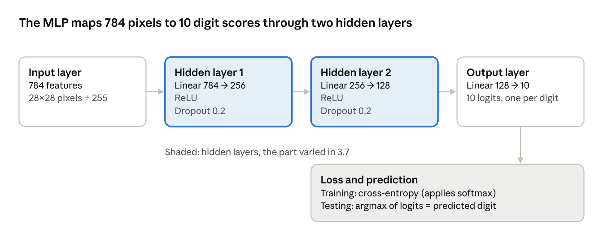
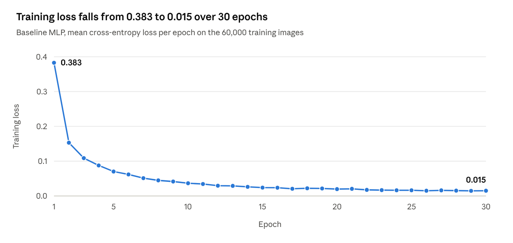
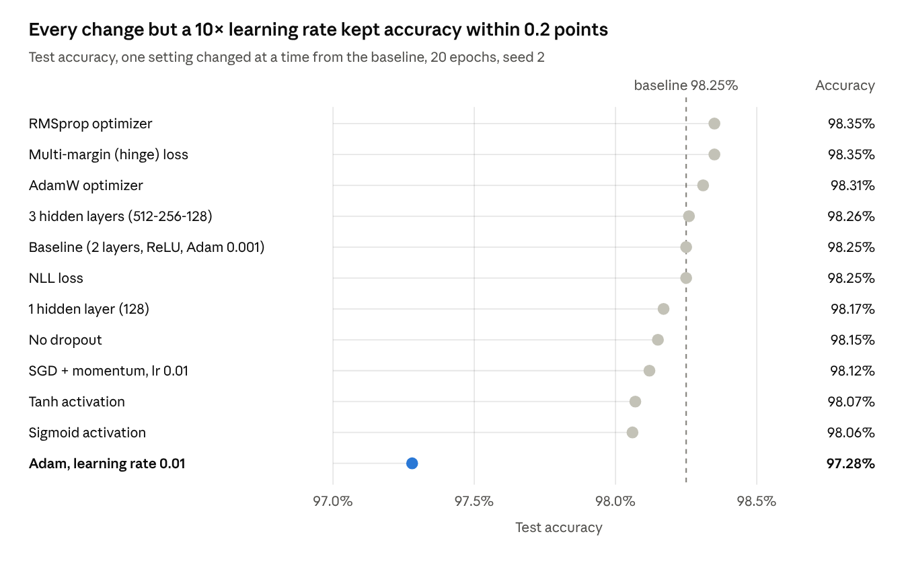

# ECS 170 Fall 2026 Course Project: Stage 2 Report

## Team Information

**Team name:** [Enter team name]

| Student | Name | Student ID | Email |
| --- | --- | --- | --- |
| 1 | [Name] | [ID] | [Email] |
| 2 | [Name] | [ID] | [Email] |
| 3 | [Name] | [ID] | [Email] |
| 4 | [Name] | [ID] | [Email] |
| 5 | [Name] | [ID] | [Email] |

## Section 1: Task Description

We trained a multi-layer perceptron (MLP) in PyTorch that classifies 28×28 grayscale images of handwritten digits into 10 classes (0–9), reaching 98.44% test accuracy. Each image is given as 784 pixel intensities, and the model learns a mapping from those features to a digit label.

The work follows the course code template: we wrote a new dataset loader, a setting for the pre-partitioned train/test data, a 10-class MLP, and multi-class evaluation metrics. We then varied depth, dropout, activation, optimizer, loss and learning rate to see how each affects performance.

## Section 2: Model Description

Our model is a fully connected MLP with two hidden layers of 256 and 128 units, implemented as `Method_MLP` on top of the template's `method` base class.



Each hidden layer is a linear transform followed by a ReLU activation and dropout (p = 0.2), which randomly zeroes 20% of activations during training to reduce overfitting. The output layer produces 10 unnormalized scores (logits). During training, cross-entropy loss turns them into probabilities with softmax and compares them with the true label. During testing, the class with the largest logit is the prediction. The model has 235,146 trainable parameters: 200,960 in layer 1, 32,896 in layer 2 and 1,290 in the output layer.

## Section 3: Experiment Settings

### 3.1 Dataset Description

We used the instructor-provided Stage 2 dataset, which is already split into 60,000 training and 10,000 testing instances (`train.csv`, `test.csv`). Each line holds 785 comma-separated integers: the label (0–9) followed by 784 pixel features in the range 0–255. Because the split is given, we used no further train/test partitioning or cross validation. We divided every pixel by 255 so inputs lie in [0, 1].

### 3.2 Detailed Experimental Setups

| Setting | Value |
| --- | --- |
| Layer dimensions | 784 → 256 → 128 → 10 (2 hidden layers) |
| Activation | ReLU after each hidden layer |
| Dropout | 0.2 after each hidden layer (training only) |
| Output | 10 raw logits; softmax is applied inside the loss |
| Loss | Cross-entropy |
| Optimizer | Adam, learning rate 0.001 |
| Batch size / epochs | 128 / 30, training set shuffled every epoch |
| Initialization | PyTorch default for `nn.Linear` (Kaiming-uniform weights, uniform biases) |
| Random seed | 2 (NumPy and PyTorch) |
| Hardware | Apple M-series CPU; one run also on the Apple GPU (MPS) |

We removed the template's final softmax layer because `nn.CrossEntropyLoss` already applies log-softmax, and applying softmax twice weakens the gradients. We also switched from full-batch to mini-batch training, which suits a 60,000-instance training set. Only one dataset is used, so there is one set of settings.

### 3.3 Evaluation Metrics

We report Accuracy, Precision, Recall and F1 on the test set. Accuracy is the share of test images classified correctly. For each class, precision is the share of predictions of that class that are correct, recall is the share of that class's images that are found, and F1 is their harmonic mean. Because this is a 10-class problem, we average the per-class scores two ways: **macro** (every class counts equally) and **weighted** (each class weighted by its number of test images).

### 3.4 Source Code

Source code: <https://github.com/bettyckang/ECS170-project/tree/stage-2>. The Stage 2 code lives in `local_code/stage_2_code/` (Dataset_Loader, Method_MLP, Setting_Train_Test_Given, Evaluate_Metrics, Plot_Learning_Curve) and `script/stage_2_script/` (`script_mlp.py` for the main run, `script_mlp_experiments.py` for the ablations).

### 3.5 Training Convergence Plot



The loss falls 60% between epochs 1 and 2 and flattens after about epoch 20, so gradient descent with Adam converges smoothly. Training and test accuracy per epoch are in [figures/train_test_accuracy.png](figures/train_test_accuracy.png).

### 3.6 Model Performance

The baseline MLP reaches 98.44% accuracy on the 10,000 test images, and every averaged metric is within 0.02 points of it.

| Metric | Macro average | Weighted average |
| --- | --- | --- |
| Accuracy | 0.9844 | 0.9844 |
| Precision | 0.9842 | 0.9844 |
| Recall | 0.9842 | 0.9844 |
| F1 score | 0.9842 | 0.9844 |

Per class, F1 ranges from 0.977 for digit 8 to 0.993 for digit 1. Macro and weighted averages nearly match because the 10 classes are close to balanced (892 to 1,135 test images each).

### 3.7 Ablation Studies

Only the learning rate mattered much: raising Adam's learning rate tenfold to 0.01 cut test accuracy to 97.28%, while every other change stayed within 0.2 points of the 98.25% baseline. Each run changes one setting from the baseline and trains for 20 epochs with the same seed. In every run, weighted precision, recall and F1 and macro F1 are within 0.0002 of accuracy, so the chart shows accuracy alone.



- **Learning rate:** at 0.01, Adam's steps overshoot, and accuracy fell about 1 point.
- **Depth:** one hidden layer lost only 0.08 points and trained twice as fast (12.5 s vs 26.9 s). Three layers gained 0.01 points but took 43.1 s.
- **Dropout and activation:** removing dropout cost 0.10 points. ReLU beat tanh and sigmoid by about 0.2 points.
- **Optimizer:** RMSprop (98.35%) and AdamW (98.31%) edged out Adam; SGD with momentum trailed at 98.12%.
- **Loss:** NLL loss after log-softmax is mathematically the same as cross-entropy, and it gave an identical 98.25%. The multi-margin (hinge) loss tied for best at 98.35%.
- **GPU (optional 2-6):** the same baseline on the Apple GPU (MPS) took 46.4 s versus 26.9 s on the CPU, because transfer overhead outweighs the speedup for a model this small.

These runs use a single seed, so gaps under about 0.2 points may be noise. Our final model keeps the baseline settings with 30 epochs, which reached 98.44% (Section 3.6).

## Running the code

The Stage 2 data is not in the repo, because `train.csv` (110 MB) exceeds GitHub's 100 MB file limit. Download it from the Stage 2 "Dataset" link in the project description and unzip it so the files sit at `data/stage_2_data/train.csv` and `data/stage_2_data/test.csv`.

Run the scripts from their own folder with the repo root on the Python path (PyCharm does both when the repo is opened as the project):

```bash
cd script/stage_2_script
PYTHONPATH=../.. python3 script_mlp.py
PYTHONPATH=../.. python3 script_mlp_experiments.py
```

Results and plots are written to `result/stage_2_result/`.
